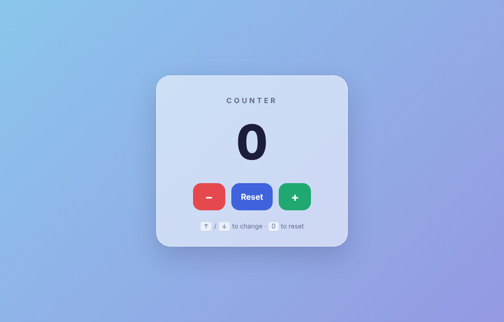

# Counter

A tiny counter app built with React — my very first React project, rebuilt in 2026.



**Live demo:** https://patcont.github.io/counter

## Features

- Increment, decrement and reset
- Keyboard shortcuts: <kbd>↑</kbd> / <kbd>↓</kbd> (or <kbd>+</kbd> / <kbd>−</kbd>) and <kbd>0</kbd> to reset
- Remembers your count between visits (`localStorage`)
- Color feedback for positive / negative values, accessible live region

## Tech

React 19 · Vite · Vitest + Testing Library · plain CSS

## Run it locally

```bash
npm install
npm run dev      # dev server
npm test         # unit tests
npm run build    # production build in dist/
npm run deploy   # publish to GitHub Pages
```

## History

The original 2022 version was a Create React App class component styled with Bootstrap.
In 2026 it was migrated to Vite and React 19 hooks, Bootstrap was replaced with ~100 lines of CSS,
and tests and keyboard support were added. The original code lives in the git history.
